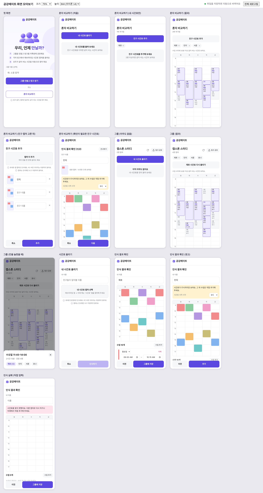
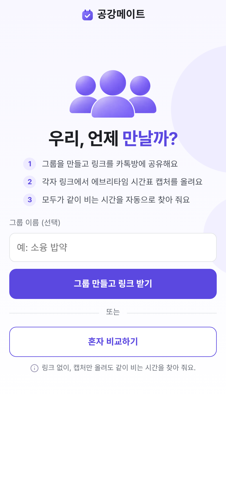
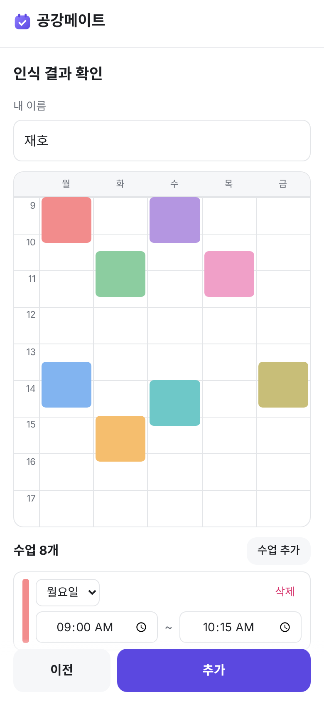
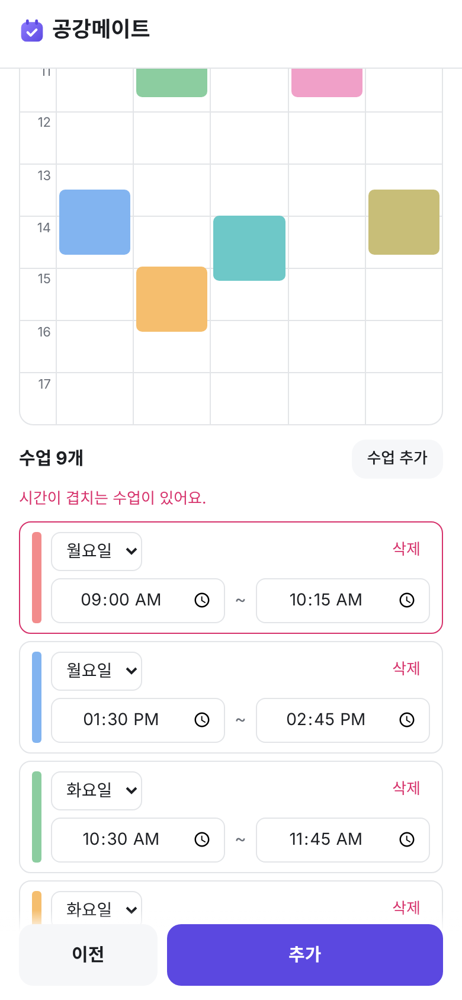
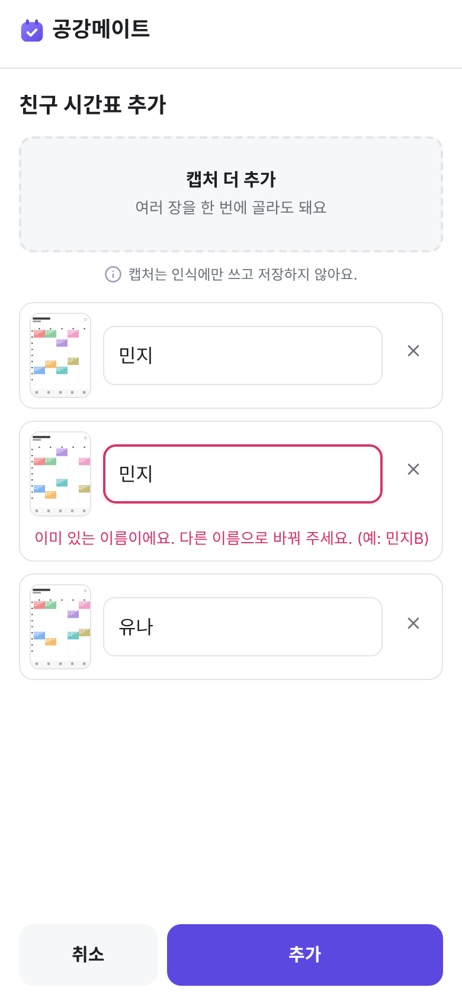
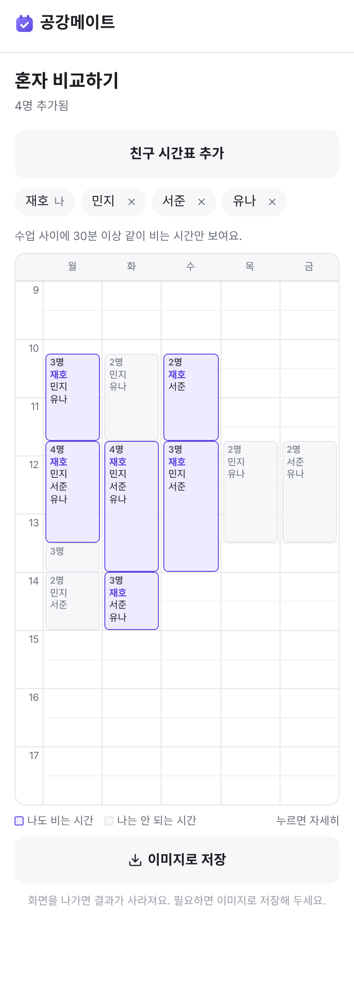
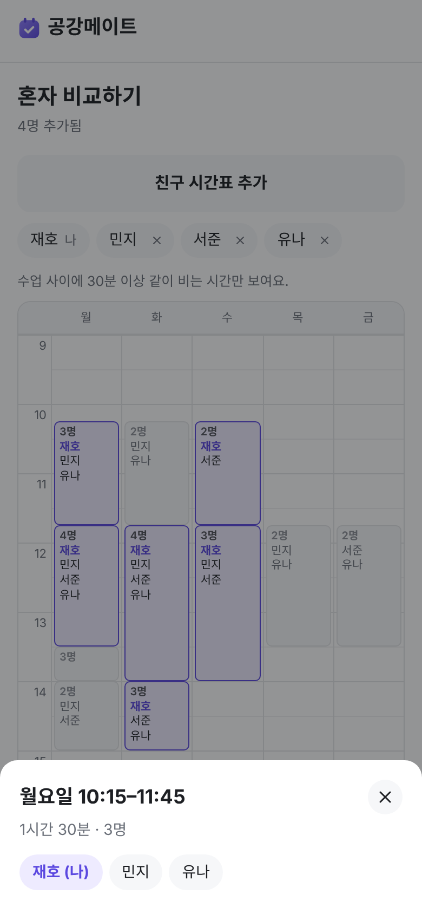
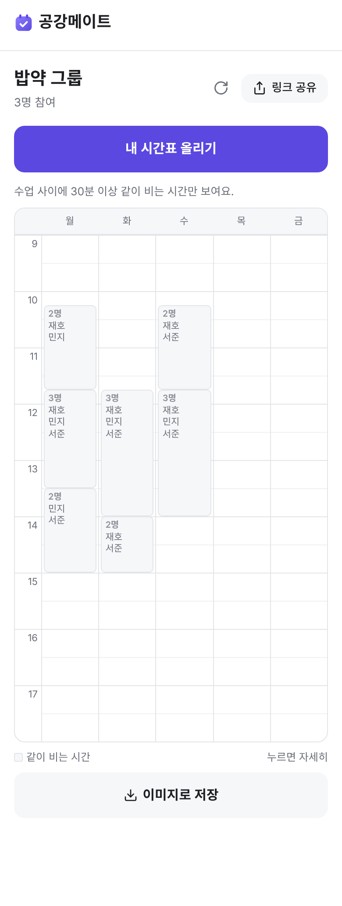

# 공강메이트

에브리타임 시간표 캡처로 친구들과 함께 비는 공강 시간을 찾아주는 모바일 웹앱.

**문제.** 학기 초에 친구들과 공강을 맞추려면 에브리타임에서 친구 시간표를 한 명씩 열어 보며 빈 시간을 머릿속으로 맞춰야 한다. 3명만 넘어가도 한눈에 비교하기 어렵고, 같이 보낼 수 있는 시간을 놓치기 쉽다. 캡처를 AI 챗봇에 보내 물어봤을 때는 수업 시간을 잘못 읽어 틀린 공강을 알려줘서, 결국 시간표와 다시 대조해야 했다.

**해결.** 시간표 캡처를 올리면 글자를 읽는 AI가 아니라 정해진 규칙으로 색과 위치(픽셀)만 읽어 수업 시간을 뽑는다. 그래서 같은 캡처에는 항상 같은 결과가 나온다. 읽은 수업 시간을 합쳐 모두가(또는 일부가) 같이 비는 시간을 주간 시간표에 이름과 함께 보여준다.

**대상.** 같은 학교에서 에브리타임을 쓰는 대학생, 3~6명 규모의 친구 무리.

- **그룹 링크 (F7):** 그룹을 만들어 카톡방에 링크를 올리면, 각자 자기 시간표 캡처를 올리는 대로 공통 공강이 자동으로 보인다.
- **혼자 비교하기:** 링크 없이 내 시간표와 친구 캡처 여러 장을 올려 바로 비교한다. 서버에 저장하지 않고, 화면을 나가면 사라진다.
- **결과 이미지 저장:** 그룹과 혼자 비교하기의 결과를 이미지(PNG)로 저장하거나 공유한다.

## 코드 읽는 순서 (채점자용)

핵심 로직은 서버 쪽 `core/` 에 있고, 전부 합쳐 약 1,000줄이다. 아래 순서로 읽으면 빠르다.

| 순서 | 파일 | 볼 내용 |
|---|---|---|
| 1 | `core/parser.py` (425줄) | 시간표 캡처를 읽는 핵심. 파일 맨 위 설명에 처리 단계 0~5가 적혀 있고, 조정 값은 위쪽 상수에 모아 두었다. 진입 함수는 `parse_timetable` |
| 2 | `core/free.py` (140줄) | 공통 공강 계산 (5분 칸 288개). 진입 함수는 `find_overlaps` |
| 3 | `core/handlers.py` (62줄) | 요청 검사와 예외를 상태 코드(413, 422, 400)로 바꾸는 곳 |
| 4 | `core/group.py`, `core/store.py` | 그룹 규칙(이름, 저장 검증)과 저장소(Supabase 또는 메모리) |
| 5 | `api/*.py` (각 25~31줄) | 요청을 받아 `core` 로 넘기기만 한다 |
| 6 | `public/js/` (13개 파일) | 화면 동작. 파일 이름이 역할이다 (예: 예외 처리 `errors.js`, 그룹 `group.js`). 전체 구조는 아래 "구조" |
| 7 | `tests/` | 아래 "테스트와 측정". `python -m pytest` 한 줄로 실행, 기대 결과는 실패 0개 |

실행해 보려면 아래 "설치와 실행" 4단계면 된다. 코드만 볼 때는 실행하지 않아도 된다.

## 실행 환경

| 항목 | 내용 |
|---|---|
| Python | 3.11.9 (Windows)에서 개발·테스트. 3.13 에서도 테스트 통과 확인 |
| 필수 패키지 | `Pillow>=10.0` (`requirements.txt`) |
| 테스트용 | `pytest` (화면 테스트는 `playwright`와 크롬, 선택 사항) |
| 브라우저 | 휴대폰 Safari·Chrome, 카카오톡 앱 안 브라우저 (모바일 웹) |
| 외부 서비스 | 그룹 기능만 Supabase 필요 (없으면 메모리에 저장). 배포는 Vercel |

## 설치와 실행

사전 준비: Python 3.11 이상 (`python --version` 으로 확인)

1. 프로젝트 폴더로 이동한다 (zip 이면 압축을 풀고 그 폴더를 연다). 아래 명령은 모두 이 폴더에서 실행한다.
2. 패키지를 설치한다.

    ```bash
    pip install -r requirements.txt
    ```

3. 서버를 실행한다.

    ```bash
    python dev_server.py
    ```

4. 브라우저에서 **http://localhost:8000** 을 연다.

여기까지 하면 앱이 뜨고 모든 기능을 쓸 수 있다. 다른 설정이나 계정은 필요 없다. (그룹 저장은 Supabase 설정이 없으면 서버 메모리에 저장되며, 서버를 끄면 사라진다.)

시험해 볼 시간표 이미지는 `samples/demo-result/` 에 4장이 들어 있다 (합성 데이터, 실제 사람의 시간표가 아님). 공통 공강이 나오도록 만든 것이다.

**참고 (필요할 때만)**
- 휴대폰으로 접속: 같은 와이파이에서 `http://<PC의 IP>:8000`
- 시연용 캡처를 새로 만들기: `python tools/make_samples.py` (`samples/demo` 에 4장 생성)
- 화면을 폰 크기로 나란히 보기(개발용): 서버를 켠 채 `http://localhost:8000/_screens`
- 테스트는 "테스트와 측정", 배포는 "배포", Supabase 설정은 "그룹 기능 설정"을 본다.

## 사용법

에브리타임에서 시간표를 캡처해 두고 시작한다. 두 가지 방법이 있다.

**그룹 링크로 모으기** (친구가 직접 올림)
1. 첫 화면에서 그룹 이름(선택)을 적고 "그룹 만들고 링크 받기"를 누른다.
2. "링크 공유"로 카카오톡방에 링크를 올린다.
3. 각자 링크를 열어 "내 시간표 올리기"에서 캡처 한 장과 이름을 올린다.
4. 인식된 수업이 맞는지 확인하고 틀린 곳은 고친 뒤 "그룹에 저장"을 누른다. (겹치는 수업이나 같은 이름은 저장되지 않고 안내가 뜬다.)
5. 그룹 화면의 주간 시간표에 같이 비는 시간과 되는 사람 이름이 자동으로 나타난다. 칸을 누르면 자세히 볼 수 있고, "이미지로 저장"으로 카톡방에 결과를 올릴 수 있다.

**혼자 비교하기** (링크 없이, 서버에 저장하지 않음)
1. 첫 화면에서 "혼자 비교하기"를 누르고 내 시간표를 먼저 올린다.
2. "친구 시간표 추가"에서 친구 캡처를 여러 장 한 번에 고르고, 카드마다 이름을 적고 "추가"를 누른다.
3. 인식에 문제가 있는 장만 확인 화면으로 넘어간다. 고치거나 건너뛸 수 있다.
4. 같은 결과 화면이 나온다. 화면을 나가면 사라지니 필요하면 "이미지로 저장"을 쓴다.

## 테스트와 측정

```bash
python -m pytest               # 단위 테스트 (공강 계산, 이미지 인식, API, 그룹)
pip install playwright && python -m playwright install chromium
python -m pytest tests/e2e --e2e   # 화면 흐름 테스트 (E2E_CHROME 으로 크롬 경로 지정 가능)
# 그룹 SQL까지 실제 PostgreSQL로 검증하려면 (psycopg 필요)
PG_TEST_DSN="host=localhost user=postgres dbname=postgres" python -m pytest tests/test_group.py
python tools/evaluate.py samples/real   # 실제 캡처 정확도·속도 측정 (비기능 요구사항)
```

`python -m pytest` 의 기대 결과는 **실패 0개**다. Supabase 연동 테스트 4개(`PG_TEST_DSN` 환경변수가 있을 때만 실행)와 화면 테스트(`--e2e` 옵션이 있을 때만 실행)는 기본 실행에서 건너뛴다. 개발 환경(Python 3.11.9, Windows)에서는 `65 passed` 로 통과했다. 화면 테스트는 리눅스(Python 3.13)에서 `10 passed` 로 확인했다.

`samples/real/` 에 실제 캡처 `이름.png` 와 정답 `이름.json` 을 같이 둔다. 정답 형식은 `samples/demo/*.json` 참고. 실제 캡처는 친구들의 시간표라 저장소에 올리지 않는다.

## MVP 체크리스트

중간고사 계획서(03 기능 요구사항)의 기능별 상태. MVP는 F1~F6, 확장은 F7·F8이다.

| 기능 | 상태 | 내용과 이유 |
|---|---|---|
| F1 시간표 이미지 자동 인식 | 완성 | 실제 캡처 10장 94개 블록을 100% 인식, 시각 오차 최대 0분. 다크모드도 지원 |
| F2 인식 결과 확인·수정 | 완성 | 수업 추가·수정·삭제, 가려진 캡처 경고. 겹치는 수업은 다음 단계로 넘어가지 못하게 막음 |
| F3 여러 장 업로드·이름 지정 | 완성 (방식 변경) | 혼자 비교하기에서 내 시간표를 먼저 올리고, 친구 캡처는 여러 장을 한 번에 골라 카드에 이름을 붙인다. 그룹에서는 각자 자기 캡처를 올린다 |
| F4 공통 공강 계산·시간표 표시 | 완성 | 수업과 수업 사이에 같이 비는 시간을 주간 시간표에 표시 |
| F5 최소 시간 필터 | 미완성 (의도적으로 제외) | 같은 시간을 사람마다 다른 용도로 쓰고 조작이 늘어나 복잡해져서, 30분 미만은 항상 제외하는 하나의 기준으로 고정했다 |
| F6 차선 시간 추천 | 완성 (표시 방식 변경) | "빠지는 사람" 대신 칸마다 같이 되는 사람 이름을 보여준다 (넘치면 '외 N명') |
| F7 그룹·초대 링크 (확장) | 완성 | Supabase에 저장, 링크로 참여, 15초마다 자동 갱신 |
| F8 다양한 캡처 지원 (확장) | 부분 완성 | 라이트·다크모드와 9시 이전 시작(시작 시각 보정)은 완료. 태블릿·PC·갤럭시 캡처는 확인하지 못했다 |

비기능 요구사항 측정 결과 (`python tools/evaluate.py samples/real`)

| 구분 | 기준 | 결과 |
|---|---|---|
| 정확성 | 블록 95% 이상, 오차 ±5분 | 94/94 (100%), 최대 오차 0분 |
| 성능 | 6장 5초 이내 | 서버 내부 6장 환산 0.21초. 배포 사이트에서 네트워크 포함 4장 1.3초 |
| 사용성 | 예외 이미지에서 멈추지 않고 원인 안내 | 이미지 아님, 빈 파일, 일반 사진, 흰 화면, 검은 화면, 아래가 가려진 캡처 테스트 통과 |
| 개인정보 | 이미지 미저장 | 이미지는 인식 중 메모리에서만 사용. 저장하는 것은 이름과 수업 시간대뿐 |

## 계획 변경 사항

중간고사 계획에서 바뀐 내용과 이유.

| 항목 | 계획 | 실제 | 이유 |
|---|---|---|---|
| 캡처 모드 | 라이트모드 우선 | 라이트·다크 모두 자동 판단 | 받은 실제 캡처 10장 중 8장이 다크모드 |
| 수업 길이 | (언급 없음) | 5분 단위 반올림만, 길이 보정 없음 | 학교 수업이 50분·1시간 15분·2시간 50분으로 제각각이고 알바·운동 같은 개인 일정도 있어서, 보정하면 2시간 50분이 3시간으로 틀려짐 |
| 공강 범위 | 미정 | 그날 첫 수업 시작부터 마지막 수업 끝 사이만 공강 | 첫 수업 전과 마지막 수업 후는 늦게 오거나 바로 집에 가는 시간 |
| 최소 시간 필터 (F5) | 60분, 90분 선택 | 삭제, 30분 미만 고정 제외 | 조작을 줄이는 쪽이 단순하고 사용 목적이 사람마다 다름 |
| 차선 시간 (F6) | "4명 중 3명 가능"과 빠지는 사람 | 칸마다 되는 사람 이름 | 같이 만날 수 있는 사람이 더 유용한 정보 |
| 그룹 링크 (F7) | 확장 기능 | 핵심 흐름으로 격상 | 카톡방에 링크를 올리면 각자 올려서 자동 비교되는 방식이 실제 사용 방식에 가장 맞음 |
| 혼자 비교하기 | (없음) | 추가 | 친구가 링크를 열지 않거나 캡처만 모아 둔 상황, 시연에서 여러 사람을 모으지 않고 보여주기 위해. 서버에 저장하지 않음 |
| 결과 이미지 저장 | (없음) | 추가 (PNG) | 결과를 카톡방에 올리는 것이 자연스러운 공유 방식. 링크 공유는 서버 저장이 필요해 "저장하지 않는다"는 원칙과 충돌 |
| 화면 이동 | (미정) | History API로 직접 관리 | 화면을 숨기고 보이게만 했더니 뒤로가기가 사이트 밖으로 나가는 문제가 있었음 |
| 같은 이름 | (미정) | 그룹에서 같은 이름 금지 (본인 기기에서 올린 것만 다시 올릴 수 있음) | 동명이인이 실수로 남의 시간표를 덮어쓸 수 있음 |
| 개인정보 보관 | 이미지 미저장 | + 그룹은 만든 지 180일 뒤 자동 삭제 | 수업 시간대와 이름은 저장되므로 보관 기간을 정함 |
| 접근성 | (언급 없음) | 화면 낭독기·키보드 이동 지원은 하지 않음 | 시연용 모바일 웹이고 부가 기능이라 범위에서 제외 |
| 구현 일정 | 8~13주차에 나눠서 | 2026-11-18~22에 집중 구현 | 주차별로 진행하지 못하고 미룬 뒤 한 번에 몰아서 진행 |
| 개발 도구 | VSCode + Copilot | 주로 Claude (채팅형 AI 어시스턴트), Copilot은 쓰지 않음 | 아래 "개발 과정" 참고 |

## 실행 화면

휴대폰 크기(390x844)로 캡처했다. 친구들의 실제 시간표에는 이름과 수업 정보가 들어 있어 개인정보 보호를 위해 쓰지 않고, 직접 만든 합성 시간표를 썼다. `python tools/take_screenshots.py` 로 다시 만들 수 있다(playwright 필요).

**모든 화면 한눈에** (개발용 화면 모아보기 `/_screens` 를 캡처한 것, 13개 화면)



**화면별 설명**


| 화면 | 설명 |
|---|---|
|  | 첫 화면. 그룹을 만들거나 혼자 비교하기를 고른다 |
|  | 인식 결과 확인·수정. 위에 시간표 미리보기, 아래에 수업 목록 |
|  | 예외 처리: 시간이 겹치는 수업이 있으면 해당 카드를 빨갛게 표시하고 다음으로 못 넘어간다 |
|  | 예외 처리: 같은 이름은 입력 칸 아래에 안내 |
|  | 혼자 비교하기 결과. 칸마다 인원 수와 되는 사람 이름 |
|  | 칸을 누르면 나오는 상세 팝업 |
|  | 그룹 결과. 링크로 모은 3명의 시간표 |

## 개발 과정

과목 안내와 계획서에는 Copilot을 쓰는 것으로 적었지만, 실제 개발은 Claude(채팅형 AI 어시스턴트)로 진행했다. GitHub Copilot은 사용하지 않았다.

**Claude를 쓴 이유.** 앞선 팀 프로젝트(해커톤)에서 Claude로 개발해 본 경험이 있고 유료(Pro)로 구독해 쓰고 있어서, 이미 익숙한 도구로 요청하고 결과를 검증하는 편이 빨랐다. 이 프로젝트는 여러 파일을 오가며 고치고, 실제 캡처로 버그를 재현하고, 테스트를 돌리는 작업이 많아서 채팅으로 요구사항을 따진 뒤 코드를 고치고 테스트로 확인하는 방식이 잘 맞았다. 도구는 바뀌었지만 4주차에 배운 요청 방식(목적·입출력·제약조건 명시, 예시 자료 제공, 반복적 개선)은 그대로 적용했다. AI가 낸 제안은 그대로 받지 않고 내 경험과 사용 상황에 맞는지 따져서 채택하거나 거절했고, 코드는 실제 캡처로 돌려 보고 휴대폰에서 확인했다.

### AI Chat 활용 사례 (Copilot 대신 Claude)

기능 범위를 정할 때 친구들의 실제 캡처를 비교해 보고, 기능이 정말 필요한지 근거를 대 달라고 요청했다. 3명만 비교해도 5일 중 3일은 공통 공강이 없어서 차선 시간(F6)을 MVP로 올렸고, 사람마다 쓰는 용도가 달라 최소 시간 필터(F5)는 없애고 30분 고정으로 바꿨다. 인식 방식은 AI 챗봇에 캡처를 보냈다가 공강을 틀리게 알려준 경험에서 정했다. 이미지를 AI로 해석하지 않고 정해진 규칙으로 픽셀을 읽는 방식이라, 같은 캡처에는 항상 같은 결과가 나온다.

구현한 결과는 직접 실행해 보며 고쳤다. 마지막에는 한 파일에 1206줄로 뭉쳐 있던 화면 코드를 기능별 파일 13개로 나누는 리팩토링을 했다. 먼저 폴더 구조와 파일 이름을 따져서 정한 뒤 옮겼고, 옮기기 전과 후의 테스트 결과가 같은지 확인했다.

### 디버깅 사례

실제 캡처나 다른 환경에서 드러난 문제는 같은 상황을 재현하는 테스트를 만들어 고쳤다. 인식 오류처럼 중요한 버그는 고친 코드를 일부러 되돌려 테스트가 실패하는지도 확인했다.

1. **아이폰 다크모드 캡처에서 "존재하지 않는 시각입니다: 24:10" 오류가 나고 시각이 모두 어긋남**
    - 원인: 격자 위의 얇은 가로선(학기 탭 밑줄 등)을 1시간 눈금으로 섞어서 간격을 68px(실제 74px)로 계산
    - 해결: 눈금을 직선에 맞춰 벗어난 선을 거르고(`_fit_grid`), 이웃한 눈금 쌍이 많은 후보를 우선(`_regular_run`). 회귀 테스트 `test_header_lines_above_grid_do_not_skew_scale` 추가, 이전 코드에서 실패하고 수정 후 통과 확인
2. **월요일 블록이 시간 칸 세로선을 덮는 캡처에서 격자가 15시에서 끊김**
    - 원인: 세로선이 한 칸만 가려져도 격자가 끝난 것으로 판단
    - 해결: 한 칸만 가려진 경우는 끊김으로 보지 않도록 고침. 회귀 테스트 `test_block_touching_label_line_does_not_cut_grid` 추가, 이전 코드에서 실패하고 수정 후 통과 확인
3. **17시 이후 수업이 없는 캡처에도 "아래가 잘렸을 수 있음" 경고가 뜸**
    - 원인: 에브리타임은 수업이 없어도 17시까지 보여 주는데 18시를 기준으로 판단
    - 해결: 기준을 17시로 고침. `test_default_range_grid_ending_at_17_has_no_warning` 추가
4. **뒤로가기를 누르면 사이트 밖으로 나감**
    - 원인: 화면을 숨겼다 보였다만 해서 브라우저 기록이 남지 않음
    - 해결: History API(`pushState`, `popstate`)로 화면마다 기록을 한 칸씩 남김. 화면 테스트로 확인
5. **확인 화면에서 이전으로 돌아오면 이미 추가한 친구 카드가 다시 나옴**
    - 원인: 뒤로가기 문제와 같은 화면 이동 구조
    - 해결: 위와 같은 방식으로 고쳐 남은 카드만 보이게 함. `test_friend_review_only_for_problem_captures_and_back_keeps_only_remaining` 추가
6. **아이폰에서 시간 입력 칸이 카드 밖으로 삐져나옴**
    - 원인: 사파리가 입력 칸에 기본 모양을 입힘 (첫 수정은 효과 없었음)
    - 해결: `appearance: none`과 최소 너비 설정. 실제 아이폰으로 확인
7. **리눅스에서 통과하던 `test_create_save_and_get`이 Windows에서만 실패 (멤버 순서가 바뀜)**
    - 원인: Windows는 시계 해상도가 거칠어 연속 저장에 같은 시각이 찍히고, 같은 시각이면 이름순으로 정렬해 순서가 바뀜
    - 해결: 이름 기준을 빼고 저장한 순서를 유지하도록 `core/store.py` 수정. 같은 시각을 강제로 고정해 재현하고 통과 확인

### 코드 리뷰 반영 사례

완성한 뒤 코드와 동작을 항목별로 점검하고, 반영할지 직접 결정했다. 동명이인이 생길 때 어떻게 할지 논의해서, 같은 이름이면 덮어쓸지 묻는 선택지는 실수로 남의 시간표를 덮어쓸 수 있어 없애고 이름을 바꾸게 했다. 오류는 입력 칸 아래에 한 줄로 안내한다. 이름과 수업 시간대는 DB에 남는다는 점을 확인하고, 만든 지 180일이 지난 그룹을 매일 자동으로 지우는 Supabase 예약 작업을 등록했다. 직접 써 보다가 수업이 겹쳐도 다음 화면으로 넘어가던 문제를 발견해서, 겹치면 넘어가지 못하게 막고 겹치는 카드를 빨갛게 표시했다.

제출 직전 최종 코드 리뷰에서는 이상한 입력을 직접 넣어 보며 서버 오류(500)가 나는 경우 두 가지를 찾아 고쳤다. 파일은 4MB 이하지만 해상도가 아주 큰 이미지는 풀기 전에 크기를 확인해 "해상도가 너무 큼"으로 안내하고(`core/parser.py`의 `MAX_PIXELS`), `/api/free`에 객체가 아닌 수업 값이 오면 400으로 안내한다(`core/free.py`). 각각 회귀 테스트를 추가했고, 고치기 전 코드에서는 실패하는 것을 확인했다.

반대로 요청 횟수 제한 같은 운영 보안과 화면 낭독기 지원은 시연용 앱의 범위를 넘는다고 판단해 구현하지 않고, 실제 서비스로 낼 때 할 일로 이 문서에 기록했다. 입력 중 실시간으로 같은 이름을 검사하는 방식도 검토했지만 추가 버튼을 눌렀을 때만 확인하는 기존 방식이 낫다고 판단해 바꾸지 않았다.

`CLAUDE.md` 는 이 프로젝트의 작업 규칙(한국어, 테스트 통과 확인, 비밀 키 비커밋)을 AI 어시스턴트에게 알려주는 파일이다. 서비스 동작과는 관련이 없다.

## 배포 (Vercel)

1. GitHub에 올리고 Vercel에서 저장소를 Import (Framework: Other)
2. `vercel.json` 설정대로 `public/` 은 정적 파일, `api/*.py` 는 Python 함수가 된다.
3. 첫 배포 후 `/api/parse` 가 `ModuleNotFoundError: core` 를 내면 `vercel.json` 의 `includeFiles` 설정을 확인한다.

## 그룹 기능 설정 (Supabase)

1. supabase.com 에서 새 프로젝트를 만든다 (Region: Northeast Asia (Seoul)).
2. SQL Editor 에 `supabase/schema.sql` 전체를 붙여 넣고 Run. 이어서 `supabase/schedule.sql` 도 Run 하면 180일 지난 그룹이 매일 자동으로 지워진다.
3. 두 값을 복사한다.
   - Project URL (`https://xxxx.supabase.co`)
   - Secret key (`sb_secret_...`). 예전 프로젝트라면 Legacy 탭의 `service_role` 키도 동작한다.
     **브라우저 코드나 GitHub에 절대 넣지 않는다.**
4. Vercel → 프로젝트 → Settings → Environment Variables 에 추가하고 다시 배포한다.
   - `SUPABASE_URL` = Project URL
   - `SUPABASE_SERVICE_KEY` = Secret key (`sb_secret_...`)
5. 로컬에서는 환경변수가 없으면 메모리에 저장한다 (`python dev_server.py`, 서버를 끄면 사라짐).

### 데이터 구조 (10주차 SQL)

```
groups (id, name, created_at)
  └─ members (id, group_id → groups, name, updated_at)   UNIQUE(group_id, name)
       └─ classes (id, member_id → members, day, start_time, end_time, color)
```

- `get_group(그룹ID)`: `groups LEFT JOIN members LEFT JOIN classes` 로 그룹 전체를 한 번에 조회
- `save_member(...)`: 멤버 추가·수정과 수업 목록 교체를 한 트랜잭션으로 처리. 같은 이름이면 `NAME_TAKEN`
- `delete_old_groups(180)`: 만든 지 180일 지난 그룹 정리. `supabase/schedule.sql` 이 pg_cron 으로 매일 실행한다.
- `delete_member(...)`: 멤버 삭제. 화면에서 멤버를 뺄 수 있게 하지 않아서 현재는 쓰지 않는다.
- 세 테이블 모두 RLS를 켜고 정책을 두지 않아, 공개 키로는 읽고 쓸 수 없다. 서버만 secret 키로 함수를 호출한다.

### 사람 구분 (로그인 없음)

- 그룹은 추측할 수 없는 UUID 링크(`?g=...`)로 구분한다. 링크를 가진 사람만 보고 올릴 수 있다.
- 내가 올린 멤버 ID는 그 기기의 localStorage 에만 기억해서 "내 시간표 다시 올리기"와 결과 화면의 '나' 강조에 쓴다.
- 같은 이름은 이 기기에서 올린 본인 것만 다시 올릴 수 있고, 그 밖에는 이름을 바꾸게 한다(덮어쓰기 선택지 없음).

## 개인정보

- 캡처 이미지는 인식하는 동안 메모리에서만 쓰고 저장하지 않는다.
- 인식은 글자를 읽는 방식(OCR)이 아니라 색과 위치만 보는 규칙 기반이라, 과목명·교수·강의실은 읽지도 저장하지도 않는다.
- 그룹에 저장하는 것은 이름과 수업 시간대(요일, 시작·끝 시각, 색)뿐이다. 공강을 계산하는 데 꼭 필요한 정보만 남긴다.
- 그룹 링크를 아는 사람은 화면에 보이는 이름·공강 외에도, 서버 응답(`GET /api/group`)에 담긴 각 멤버의 수업 시간대를 볼 수 있다. 화면에는 표시하지 않는다.
- 혼자 비교하기는 서버에 아무것도 저장하지 않는다.
- 이 저장소의 샘플, 테스트, README 화면 캡처는 모두 직접 만든 합성 시간표이고 실제 사람의 시간표는 들어 있지 않다. 정확도 측정에 쓴 실제 캡처(`samples/real/`)는 친구들의 개인정보라 저장소에 올리지 않았다(`.gitignore`).
- 그룹은 만든 지 180일이 지나면 자동으로 지워진다(`supabase/schedule.sql` 의 매일 실행 작업). 이 작업을 등록하지 않으면 지워지지 않는다.

## 구조

이 프로젝트는 세 구역으로 나뉜다. 폴더 이름만으로는 구분이 안 되니 아래 표로 확인한다.

| 구역 | 폴더 | 실행되는 곳 |
|---|---|---|
| 프런트엔드 (화면) | `public/` | 사용자의 브라우저 |
| 백엔드 (서버) | `api/`, `core/` | Vercel 서버 (Python) |
| 데이터베이스 | `supabase/` | Supabase (PostgreSQL) |
| 개발·검증용 | `tests/`, `tools/`, `dev/`, `dev_server.py`, `samples/`, `docs/` | 내 컴퓨터에서만 (서비스에는 쓰이지 않음) |

```
public/                프런트엔드: 브라우저에서 실행되는 화면
  index.html           화면 뼈대 (#step-* 구역이 화면 하나씩)
  style.css            모양 (CSS 는 여기만)
  img/                 첫 화면 그림, 아이콘
  js/                  화면 동작. index.html 에 적힌 순서대로 불러온다
    state.js           상수와 전역 상태
    utils.js           범용 도구 (DOM 만들기, 시간 변환, 서버 요청, 이 기기 저장소)
    errors.js          예외 처리: 겹치는 수업, 같은 이름, 입력 검증, 오류 표시
    navigation.js      화면 전환과 뒤로가기 (History API, popstate)
    timetable.js       주간 시간표 그리드, 공강 결과 그리기
    recognize.js       캡처 인식 요청 (/api/parse)
    result-image.js    결과를 PNG 이미지로 그려 저장 (canvas)
    modal.js           팝업 (구간 상세, 캡처 크게 보기, 이미지 보기)
    group.js           그룹: 만들기, 불러오기, 공유, 새로고침, 저장
    solo.js            혼자 비교하기
    upload.js          시간표 올리기 화면, 친구 캡처 카드
    review.js          확인·수정 화면
    main.js            이벤트 연결과 시작 (가장 마지막)

api/                   백엔드 입구: 요청을 받아 core 로 넘기기만 한다 (Vercel 규칙상 이 이름과 위치 고정)
  parse.py             POST /api/parse  캡처 한 장 -> 수업 목록
  free.py              POST /api/free   멤버 시간표들 -> 공통 공강
  group.py             GET/POST /api/group  그룹 만들기·조회·내 시간표 저장 (F7)
core/                  백엔드 핵심 로직
  handlers.py          요청 검사와 예외 -> 상태 코드 변환 (서버 예외 처리의 중심)
  parser.py            이미지 인식 (Pillow, 규칙 기반)
  free.py              공강 계산 (5분 칸 288개, 같은 사람 조합이 이어진 구간으로 묶기)
  group.py             그룹 규칙 (이름, 멤버 저장 검증)
  store.py             Supabase 호출 / 메모리 저장소
  time_utils.py        시각 문자열 <-> 분 변환, 요일 상수
supabase/
  schema.sql           테이블·SQL 함수·권한
  schedule.sql         오래된 그룹을 매일 지우는 예약 작업 (pg_cron)

tests/                 pytest (tests/synth.py 가 합성 캡처 생성)
  e2e/                 화면 흐름 Playwright 테스트 (--e2e 로만 실행)
tools/                 시연 샘플 생성, 정확도 측정, README용 실행 화면 캡처
docs/screens/          README 에 넣은 실행 화면 이미지
dev/screens.html       화면 모아보기 (개발용, dev_server 에서만 열림)
dev_server.py          내 컴퓨터용 개발 서버 (화면과 API를 함께 띄움)
samples/demo/          시연용 합성 캡처와 정답 JSON (tools/make_samples.py 로 생성)
samples/demo-result/   공통 공강이 나오도록 만든 합성 캡처 4장 (바로 시험해 보기용)
                       samples/real 은 실제 캡처라 git 에 올리지 않는다
```

### 백엔드 층과 일반적인 용어의 대응

백엔드는 한 가지 방향으로만 호출한다: `api/` -> `core/handlers.py` -> `parser`·`free`·`group` -> `store`.

| 일반적인 층 | 이 프로젝트 | 하는 일 |
|---|---|---|
| 라우터(입구) | `api/*.py` | 요청을 받아 넘기고 응답을 돌려준다 (25~31줄) |
| 핸들러 | `core/handlers.py` | 입력을 검사하고, 예외를 상태 코드로 바꾼다 |
| 서비스(업무 규칙) | `core/parser.py`, `free.py`, `group.py` | 인식, 공강 계산, 그룹 규칙 |
| 저장소(데이터 접근) | `core/store.py` | Supabase 또는 메모리에 저장·조회 |

### 예외 처리가 있는 곳

| 상황 | 어디서 | 사용자에게 보이는 것 |
|---|---|---|
| 이미지가 너무 큼, 시간표가 아님, 잘못된 요청 | 서버 `core/handlers.py` | 오류 코드(413, 422, 400)와 안내 문구 |
| 같은 이름, 이름 길이 | 서버 `core/group.py`, 화면 `public/js/errors.js` | 이름 칸 빨간 테두리와 한 줄 안내 |
| 겹치는 수업, 끝나는 시각이 더 빠름 | 화면 `public/js/errors.js` | 다음 단계로 넘어가지 못하고 경고 표시 |
| 서버에 연결하지 못함 | 화면 `public/js/utils.js` (`errText`) | "서버에 연결하지 못했어요." |

## API

`POST /api/parse` — 본문은 이미지 바이트 그대로 (4MB 이하, 넘으면 브라우저에서 JPEG로 다시 저장)

```json
{"ok": true,
 "classes": [{"day": "MON", "start": "09:00", "end": "10:15", "color": "#f28c8c"}],
 "warnings": [{"code": "grid_ends_early", "message": "..."}],
 "meta": {"theme": "dark", "days": ["MON","TUE","WED","THU","FRI"], "grid_start": "09:00", "grid_end": "18:00", "px_per_hour": 120.0}}
```

실패 시 `{"ok": false, "error": {"code": "not_timetable", "message": "..."}}`
(`empty`, `not_image`, `not_timetable`, `too_large`)

`POST /api/free`

```json
{"members": [{"name": "재호", "classes": [{"day": "MON", "start": "09:00", "end": "10:15"}]}]}
```

응답
- `overlaps`: 같이 비는 공강 목록. 항목마다 `names`(되는 사람), `everyone`(전원 여부). 많은 사람이 겹치는 순서
- `segments`: 그리드 표시용으로 같은 사람들이 겹치는 구간 (서로 겹치지 않음)
- `everyone_count`: 전원이 비는 공강 수

`GET /api/group?g=<그룹ID>` → `{"ok": true, "group": {"id", "name", "members": [{"id", "name", "classes"}]}}`

`POST /api/group`
- `{"action": "create", "name": "소융 밥약"}` → `group_id`
- `{"action": "save", "group_id", "member_id"(수정 시), "name", "classes", "claim"(같은 이름 덮어쓰기, 화면에서는 쓰지 않음)}` → `member_id`

오류 코드: `GROUP_NOT_FOUND`(404), `NAME_TAKEN`(409), `GROUP_FULL`(409, 20명), `not_configured`(503, 환경변수 없음)

## 실제 서비스로 낼 때 할 일

지금은 시연용이라 하지 않은 것들이다. 불특정 다수에게 열 때 한다.

- **요청 횟수 제한**: 지금은 `/api/parse`, `/api/group` 에 호출 횟수 제한이 없다. Vercel 대시보드의 Firewall(WAF)에서 `/api/` 경로에 IP당 횟수 제한 규칙을 둔다(코드 수정 없음). 무료(Hobby) 플랜은 규칙 1개, 시간 창 최대 10분이라 한도가 빡빡하다. 더 세밀하게(그룹 만들기만 엄격하게 등) 하려면 Pro 플랜이나 서버 쪽 제한이 필요하다.
- **봇 확인**: 그룹 만들기에 캡차(Cloudflare Turnstile 등)를 붙인다.
- **사용량 감시**: Vercel·Supabase 사용량 알림과 지출 한도를 켠다.
- **접근 제어**: 지금은 링크를 아는 사람이 모두 같은 권한이다(로그인 없음). 멤버별 수정 권한이나 그룹 삭제가 필요하면 로그인을 넣는다.

## 정해 둔 규칙

- 공강 = 각자 그날 **첫 수업 시작부터 마지막 수업 끝 사이**의 빈 시간. 첫 수업 전·마지막 수업 후는 세지 않는다.
- 수업이 없거나 하나뿐인 날은 그 사람에게 공강이 없다(학교에 오지 않음). 월~금만 계산한다.
- 2명 이상이 같이 비는 시간을 모두 보여 주고, 그때 되는 사람 이름을 적는다. 30분 미만은 뺀다.
- 라이트모드와 다크모드 캡처를 모두 인식한다.
- 확인 화면에서 같은 요일에 시간이 겹치는 수업이 있으면(이어 붙는 것은 제외) 다음으로 넘어가지 못하고, 겹치는 줄이 빨갛게 표시된다.
- 인식한 시각은 5분 단위로만 반올림하고 수업 길이는 보정하지 않는다. 학교 수업(50분, 1시간 15분, 2시간 50분)과 근로·알바·운동 같은 개인 일정의 길이가 제각각이기 때문이다.
- 캡처 맨 위 가로 눈금을 09:00으로 본다. 위로 스크롤된 캡처는 확인 화면의 '캡처 맨 위 시각'으로 한 번에 옮긴다.
- 격자가 17시 전에 끝나면(아래가 가려짐) 경고하고, 그 시간대는 사용자가 직접 확인·추가한다. 에브리타임은 수업이 없어도 17시까지는 보여 주므로 17시에서 끝나는 것은 경고하지 않는다.
- 캡처 이미지는 메모리에서만 처리하고 저장하지 않는다. (위 "개인정보" 참고)

## 실제 캡처로 조정할 값

인식 기준값은 `core/parser.py` 맨 위 상수에 모여 있다. 아이폰 실제 캡처로 맞췄고, 측정에 쓴 10장(다크 8, 라이트 2, 수업 블록 94개)이 모두 정답과 일치했다. 다른 기종에서 틀리면 아래 순서로 확인한다.

| 증상 | 조정할 상수 |
|------|-------------|
| `not_timetable` (격자를 못 찾음) | `GRAY_VAL_RANGE`(테마별), `H_LINE_MIN_RATIO` |
| 요일 칸 수가 틀림 | `V_LINE_MIN_RATIO` |
| 연한 색 수업을 놓침 | `BLOCK_MIN_SAT` 낮추기 |
| 수업 하나가 둘로 쪼개짐 | `GAP_FILL_HOURS` 올리기, `HUE_SPLIT` 올리기 |
| 붙은 두 수업이 하나로 합쳐짐 | `HUE_SPLIT` 낮추기 |
| 시각이 모두 어긋나거나 24시를 넘는 시각이 나옴 | 격자 위 가로선이 눈금으로 잡힘 → `_fit_grid`, `_regular_run` 결과 확인 |
| 정각이 아닌 시작 시각이 5분 늦게 나옴 | `BLOCK_TOP_INSET_HOURS` |
